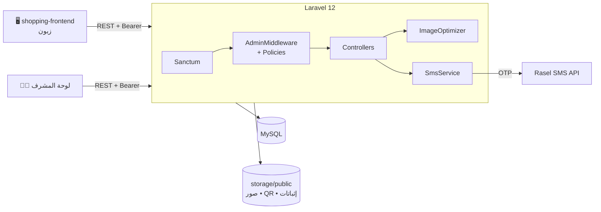
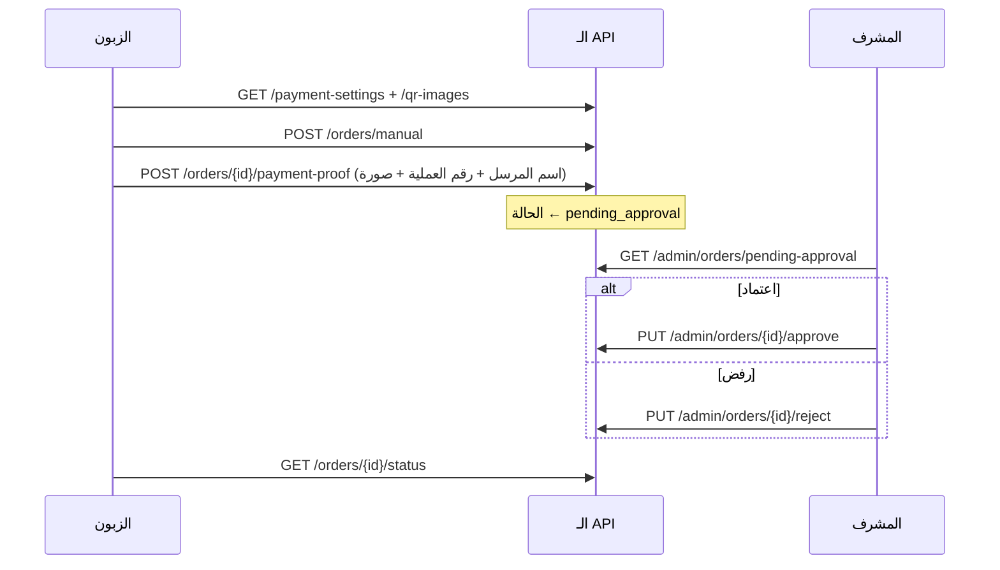

<div align="center">

# 🛍️ تسوق معنا — الخادم (Shopping API)

**واجهة برمجية لمتجر إلكتروني: منتجات، سلة، طلبات، دفع يدوي (شام كاش / USDT)، عروض، إعلانات، وتحقق بالـ OTP.**

<p>
  
  
  
  
  
</p>

[المزايا](#-المزايا) • [المعمارية](#-المعمارية) • [مسار الدفع](#-مسار-الدفع-اليدوي) • [API](#-أهم-المسارات) • [التثبيت](#-التثبيت) • [البيئة](#-متغيرات-البيئة)

</div>

---

<div dir="rtl">

## 📖 نبذة

هذا المستودع هو **الـ API** لمتجر «تسوق معنا». يخدم واجهة الويب [shopping-frontend](https://github.com/Kaisalafef/shopping-frontend)، ويدير الكتالوج والطلبات والدفع، ويدعم **عملتين (USD و SYP)** مع سعر صرف يحدّده المشرف، وتفعيل الحساب برمز **OTP** عبر رسالة نصية للأرقام السورية.

## 🧩 منظومة المشروع

| المستودع | الوصف |
|---|---|
| 🛠️ **shopping** (هذا المستودع) | الـ API — Laravel |
| 🖥️ [shopping-frontend](https://github.com/Kaisalafef/shopping-frontend) | واجهة المتجر ولوحة المشرف — HTML/CSS/JS |

## ✨ المزايا

| المجال | التفاصيل |
|---|---|
| 📦 **الكتالوج** | منتجات بصور متعددة ومقاسات وماركات وتصنيفات (مع أيقونة)، وحذف ناعم `SoftDeletes` |
| 💱 **العملات** | سعر المنتج بـ `USD` أو `SYP`، سعر صرف قابل للتعديل مع **سجل تغييرات**، ويُحفظ سعر الصرف داخل الطلب وعناصر السلة وقت الشراء |
| 🛒 **السلة والطلبات** | سلة لكل مستخدم، طلب بالدفع عند الاستلام، تتبع الحالة، وتقرير مبيعات شهري |
| 💳 **الدفع اليدوي** | شام كاش و USDT مع رفع إثبات الدفع واعتماد/رفض من المشرف |
| 🏷️ **العروض والإعلانات** | خصومات على المنتجات، وإعلانات تظهر في الصفحة الرئيسية |
| ⭐ **التقييمات** | تقييم المنتجات من الزبائن المسجّلين |
| 🔔 **الإشعارات** | إشعارات داخلية مع عدّاد غير المقروء |
| 🔐 **التحقق بـ OTP** | رمز من 6 خانات صالح 10 دقائق، إرسال عبر **Rasel SMS**، وإعادة إرسال. يمكن تعطيله بـ `OTP_ENABLED=false` |
| 📱 **أرقام الهواتف** | توحيد أي صيغة إدخال (`09…` / `9…` / `+9639…` / `009639…`) إلى `+9639XXXXXXXX` |
| 🖼️ **تحسين الصور** | ضغط تلقائي عند الرفع إلى **WebP** (PNG لصور QR)، تصحيح الاتجاه، وحذف بيانات EXIF/GPS، مع الرجوع للأصل عند أي فشل |
| 👤 **الأدوار** | `admin` و`user` عبر `AdminMiddleware` + Policies للمنتجات والعروض والإعلانات والتقييمات والسلة والإشعارات |

## 🏗️ المعمارية



## 💳 مسار الدفع اليدوي



## 🔌 أهم المسارات

> كل المسارات تحت البادئة `/api`. المحمية تتطلب `Authorization: Bearer <token>`.

**عامة**

| الطريقة | المسار | الوصف |
|---|---|---|
| `POST` | `/register` • `/login` | إنشاء حساب / دخول |
| `POST` | `/verify-otp` • `/resend-otp` | تفعيل الحساب |
| `GET` | `/products` • `/products/{id}` • `/products/category/{category}` | المنتجات |
| `GET` | `/categories` • `/offers` • `/ads` | تصنيفات وعروض وإعلانات |
| `GET` | `/reviews/product/{id}` | تقييمات منتج |
| `GET` | `/exchange-rate` • `/payment-settings` • `/qr-images` | سعر الصرف وإعدادات الدفع |

**مستخدم مسجّل**

| الطريقة | المسار | الوصف |
|---|---|---|
| `GET` `DELETE` | `/cart` • `/cart/total` • `/cart/clear` | السلة |
| `POST` `PUT` `DELETE` | `/carts/{cart}/items[/{item}]` | عناصر السلة |
| `POST` | `/orders` | طلب بالدفع عند الاستلام |
| `GET` | `/orders/user` • `/order-items/order/{id}` | طلباتي |
| `POST` `GET` | `/orders/manual` • `/orders/{id}/payment-proof` • `/orders/{id}/status` | الدفع اليدوي |
| `POST` `PUT` `DELETE` | `/reviews` | التقييمات |
| `GET` `PUT` | `/profile` | الحساب |
| `GET` `PUT` | `/notifications` • `/notifications/unread-count` • `/notifications/mark-all-read` | الإشعارات |

**مشرف (`admin`)**

| الطريقة | المسار | الوصف |
|---|---|---|
| `POST` `PUT` `DELETE` | `/products` • `/categories` • `/offers` • `/ads` | إدارة المحتوى |
| `GET` | `/orders/status/{status}` • `/orders/reports/monthly/{month}/{year}` • `/admin/orders` | الطلبات والتقارير |
| `POST` `GET` | `/exchange-rate` • `/exchange-rate/history` | سعر الصرف |
| `POST` | `/admin/payment-settings/shamcash` • `/admin/payment-settings/usdt` • `/upload-qr` | إعدادات الدفع |
| `GET` `PUT` | `/admin/orders/pending-approval` • `/approve` • `/reject` | اعتماد الدفعات |
| `GET` `DELETE` | `/admin/customers` | إدارة الزبائن |

## ⚙️ التثبيت

**المتطلبات:** PHP ≥ 8.2 (مع امتداد GD) • Composer • Node.js ≥ 18 • MySQL/MariaDB.

```bash
# 1) استنسخ المشروع
git clone https://github.com/Ameerdawara/shopping.git
cd shopping

# 2) الاعتماديات
composer install
npm install

# 3) البيئة
cp .env.example .env     # إن لم يوجد الملف أنشئ .env من القائمة أدناه
php artisan key:generate

# 4) قاعدة البيانات
php artisan migrate --seed
php artisan storage:link   # لعرض الصور وصور QR

# 5) التشغيل
php artisan serve
```

> 🔑 يُنشئ `AdminUserSeeder` حساب مشرف أولي. **غيّر بريده وكلمة مروره فوراً** قبل أي نشر.

## 🔐 متغيرات البيئة

| المجموعة | المتغيرات |
|---|---|
| التطبيق | `APP_NAME` `APP_ENV` `APP_KEY` `APP_DEBUG` `APP_URL` |
| قاعدة البيانات | `DB_CONNECTION` `DB_HOST` `DB_PORT` `DB_DATABASE` `DB_USERNAME` `DB_PASSWORD` |
| OTP / SMS | `OTP_ENABLED` `RASEL_API_URL` `RASEL_API_KEY` |
| Sanctum / CORS | `SANCTUM_STATEFUL_DOMAINS` (وأضف نطاق الواجهة في `config/cors.php`) |
| الملفات | `FILESYSTEM_DISK` |
| البريد | `MAIL_MAILER` `MAIL_HOST` `MAIL_PORT` `MAIL_USERNAME` `MAIL_PASSWORD` `MAIL_FROM_ADDRESS` |

> ⚠️ لا ترفع `.env` إلى المستودع.

## 🗂️ بنية المشروع

```
app/
├── Http/
│   ├── Controllers/   # Product, Category, Order, Payment, Cart(Card), Offer, Ad, Review, ...
│   ├── Middleware/    # AdminMiddleware
│   ├── Requests/      # Store/Update Form Requests
│   └── Resources/     # ProductResource
├── Models/            # Product, ProductImage, ProductSize, Order, OrderItem, Payment, ExchangeRate, ...
├── Policies/          # Offer, Review, Product, Cart, Notification, Ad
├── Services/          # SmsService (Rasel) • ImageOptimizer (GD → WebP)
└── Support/           # PhoneNumber (E.164 سوري)
database/
├── migrations/        # المنتجات، الطلبات، الدفع، أسعار الصرف، OTP، ...
└── seeders/           # AdminUserSeeder
routes/api.php         # كل مسارات الـ API
```

## 👥 الفريق

| الاسم | الدور |
|---|---|
| غيث رؤوف كحل | مهندس برمجيات |
| قيس أيمن العفيف | مهندس برمجيات |
| أمير سلام دواره | مهندس برمجيات |
| حلا سامر هلال | مهندسة برمجيات |
| دلع وائل عدوان | مهندسة برمجيات |

## 📄 الترخيص

مشروع خاص. جميع الحقوق محفوظة © 2026.

</div>
